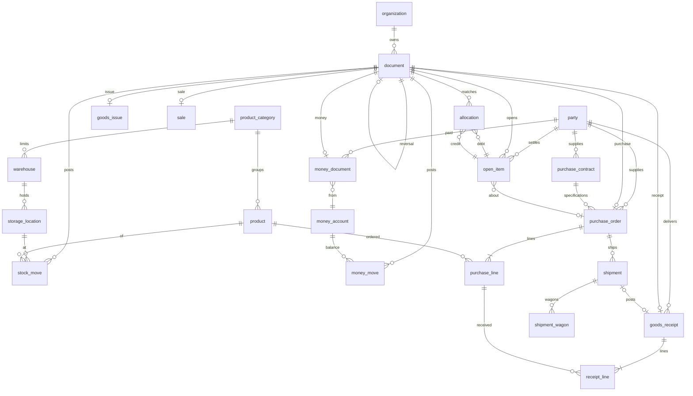
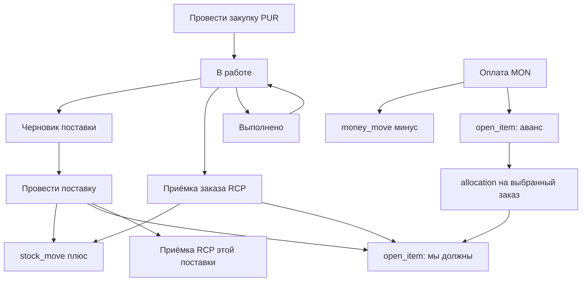

# Схема базы

Имена таблиц — как в живой базе Django. Префикса `books_` у них нет. Старые рисунки с таким префиксом лежат в `docs/EBB-Holding-2026/architecture-2026-11-10/` и описывают целевой набросок, не эти таблицы.

Остаток склада — сумма `stock_move.qty_delta`. Остаток счёта — сумма `money_move.amount_delta`. Долг — `open_item` минус неотменённые `allocation`. Отдельной ячейки «текущий остаток» для этого нет. `stock_position` только запирает пару «место + товар» на время проводки.

Закупка с заполненным `purchase_contract` — спецификация. Закупка без договора — обычный заказ. У обеих один `document` вида `PURCHASE`.

«Выполнено» на диаграмме только закрывает новые поставки и новые приёмки. Стрелки склада и долга оно не рисует: эти стрелки идут от проведения поставки и от приёмки.
