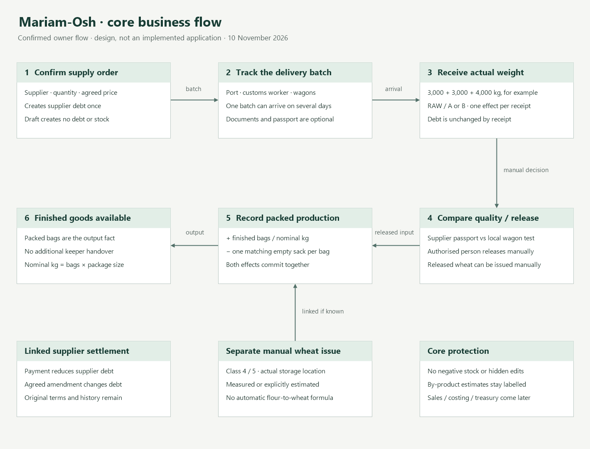
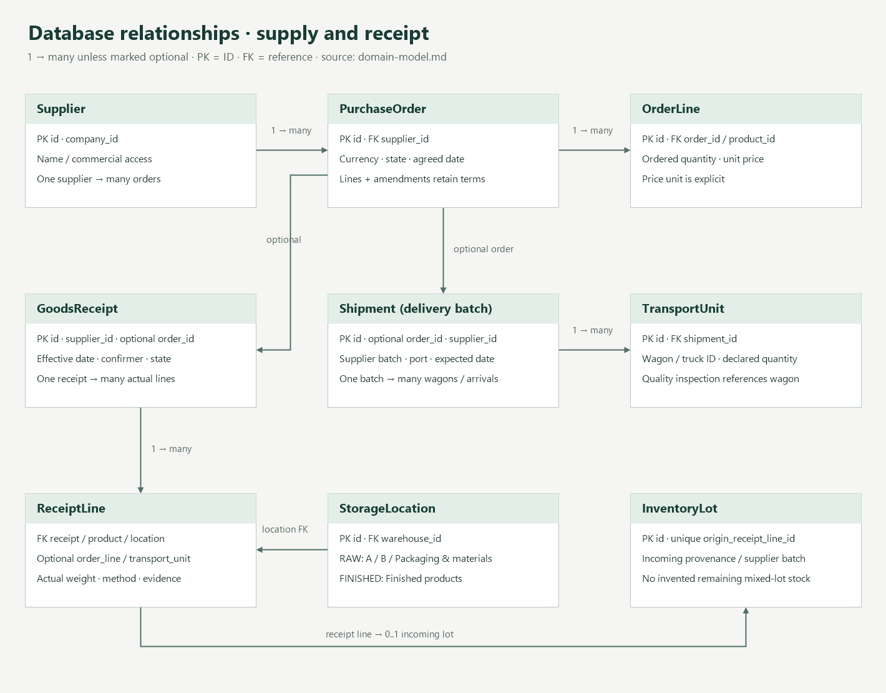
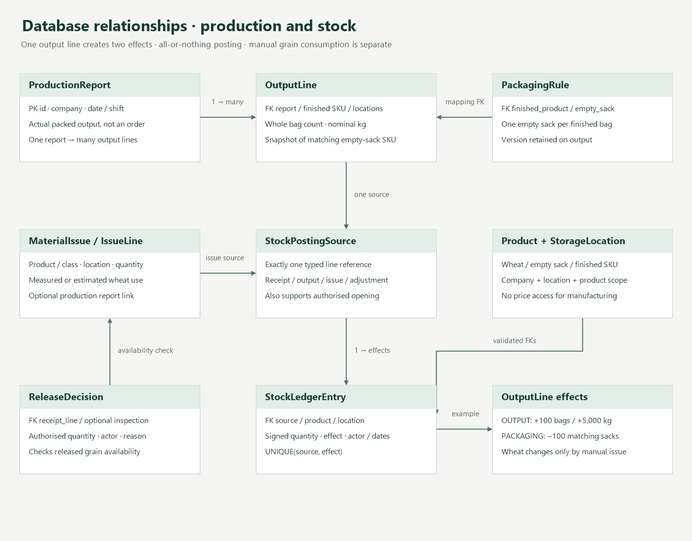

# Visual guide to the core
Read the [business rules](../business-rules.md) and [database dictionary](../data-dictionary.md) alongside these diagrams.

## Business flow

[Zoomable SVG](core-flow.svg) · [Editable Mermaid](core-flow.mmd)

## Supply and receipt tables

[Zoomable SVG](procurement-erd.svg) · [Full relationship source](supply-relations.mmd)

## Manufacturing and stock tables

[Zoomable SVG](production-erd.svg) · [Manufacturing relationships](manufacturing-relations.mmd)

The table cards are a readable overview, not the entire schema. PK identifies a row; FK points to another table. Optional references allow direct receipt without invented paperwork. The production figure includes an availability check and an example effect box; those arrows are explanatory, not additional foreign keys.

## Additional relationship diagrams
[Quality / manual release](quality-relations.mmd) and [supplier settlements](settlement-relations.mmd) are also embedded as Mermaid diagrams in [domain model](../domain-model.md).

## Maintenance
Mermaid sources describe relationships. SVG is editable vector artwork; PNG is a shareable preview. layout.json records card text, coordinates and connector paths used for the SVG/PNG overview renderings. Update relationship sources and visual previews together when schema changes.
These are repository-local documentation artifacts; they require no hosted site, database or live business data.
