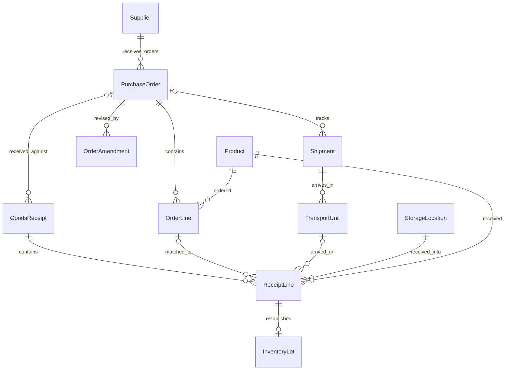
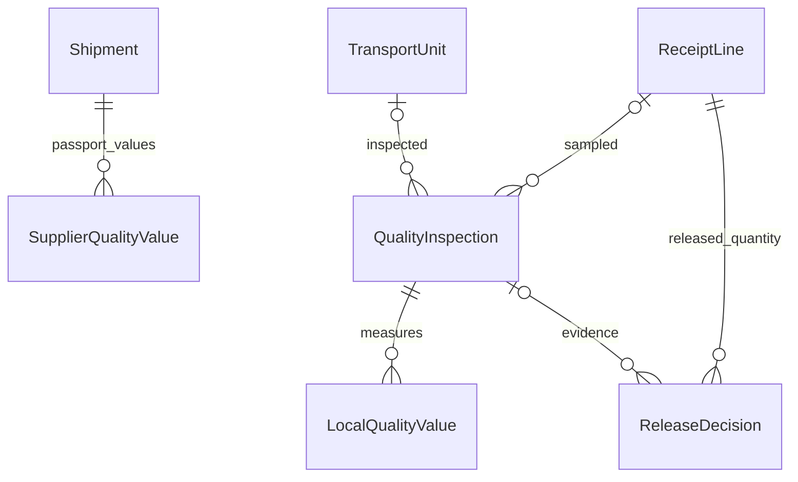
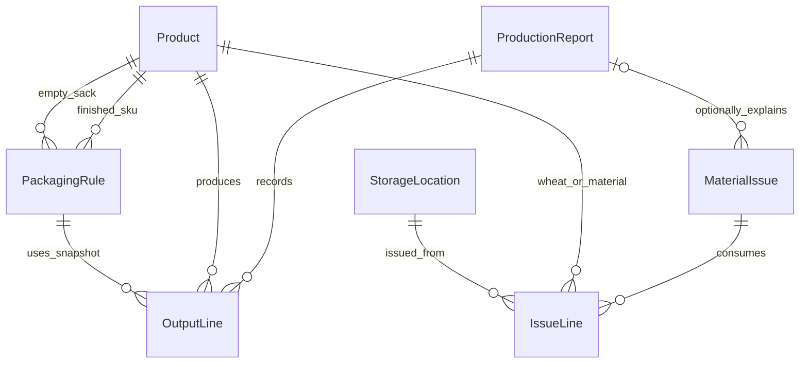
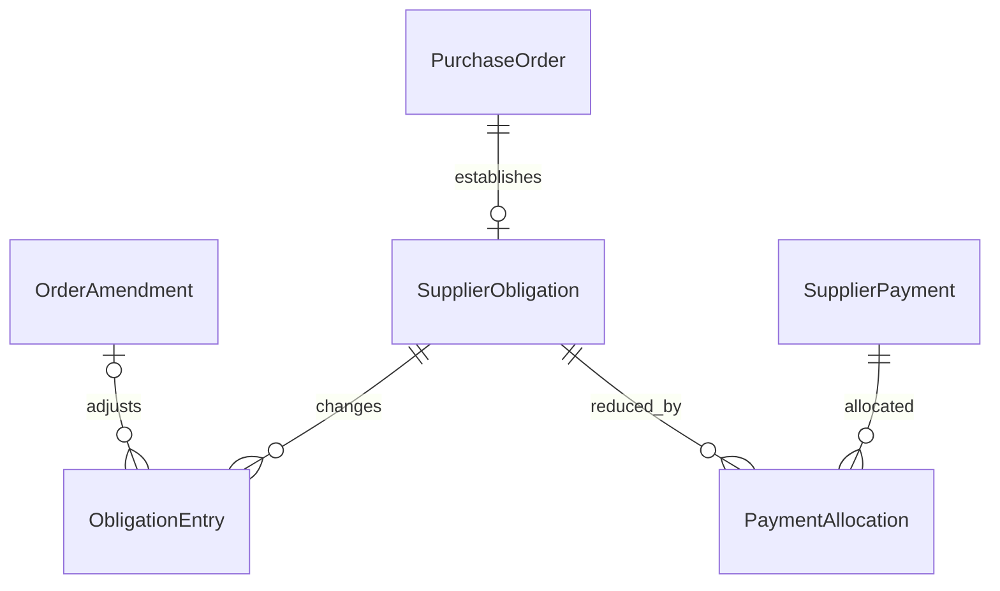

# Database relationships and posting logic
Current core design, 2026-11-10. Schema details are [ASSUMPTION] implementing [confirmed rules](business-rules.md). [Visuals](diagrams/README.md) and [table dictionary](data-dictionary.md) accompany this document.

## Supply and receipt

Supplier is required on an order/receipt. Shipment also retains supplier when no order exists. One order can contain multiple product lines and multiple supplier batches. One batch has several wagons/trucks; each may unload in more than one receipt. Receipt lines optionally match order lines and transport units; mixed order/company/supplier references are rejected. To keep the UI simple, one receipt belongs to at most one order; multiple wagons may appear as separate lines. Direct receipt remains valid without an order, transport record or attachment.

Warehouse → StorageLocation is one-to-many; each location belongs to exactly one warehouse/company. Every posted movement has a location. Storage A/B names and typical classes are reference data, not hard-coded formulas. One ReceiptLine has at most one incoming lot; confirmation requires it for wheat. Lot can exist before posting for inspection. A repeated supplier lot number across partial arrivals is allowed. Never infer a stock balance per lot after mixed/pooled issues; show incoming lot history and product/location balance separately.

## Quality and release

A supplier value has parameter name, value/text, unit and passport version/source; optional wagon-specific overrides must be explicit. A local inspection references the wagon and/or receipt line, date, employee and evidence; require at least one of those two sources. When both are present their provenance must agree. Numeric differences are computed only for matching units/parameters; no inferred pass/fail threshold. Direct receipt inspections may reference the receipt line alone, without creating a fictitious shipment/wagon. Attachment/order remains optional.

ReleaseDecision records an authorised quantity/reason and links to the received wheat. Physical receipt posts stock; release changes a derived usable-quantity balance only. Releasing cannot exceed net received quantity or double-release the same quantity. Confirming manual issues checks both physical and released pooled stock by location/product. Hold/revocation/correction cannot reduce available release below already consumed quantities. Physical mixing may make exact segregation unknown (D-06); do not claim software knows lot purity.

## Production and material use

ProductionReport is an actual fact, not a production order. OutputLine has whole bag count, finished SKU, FINISHED destination and RAW packaging source. Snapshot the matching empty-sack product and one-per-bag quantity at confirmation. One 50 kg finished bag is one product unit with 50 nominal kg; it consumes one corresponding empty sack. Different finished SKUs can reference the same sack type only if explicitly configured.

Confirming output creates FINISHED output plus RAW sack consumption in one transaction. Wheat issues are separate manual facts by wheat class/location, optionally linked to a report/shift. They do not derive from nominal flour weight. Missing grain usage remains visible as pending, not zero. A packaging-only production report is not a validated material balance or costing result. Damaged sacks use a reasoned write-off, never an automatic waste percentage.

## One quantity ledger
StockPostingSource has exactly one protected line FK: ReceiptLine, OutputLine, IssueLine, AdjustmentLine or OpeningLine. Each non-null FK is unique and a check enforces exactly one. StockLedgerEntry links source and effect with unique (source, effect).
- receipt → one positive RECEIPT entry;
- output → one positive OUTPUT and one negative PACKAGING entry;
- issue → one negative ISSUE entry;
- adjustment/opening → one signed ADJUSTMENT or authorised OPENING entry.

Ledger fields: company, location, product, signed base quantity, optional signed bag count/nominal-mass snapshot, optional incoming-lot provenance, effective date, recorded timestamp, actor, measurement basis and source. Warehouse is derived from location; do not permit inconsistent duplicate warehouse IDs. All required effects are validated and committed with the document state. Empty drafts have zero lines; confirmation requires at least one. There are no stock effects for orders, drafts, payments or quality observations.

Product uses kg as base mass unit for wheat/flour and pieces for empty packaging. Packed output stores counted bags plus nominal kg on the same effect, not independent stock increases. Exact Decimal arithmetic, explicit tonne→kg conversion, integer bag counts and immutable packaging snapshots prevent conversion drift. Actual weight observations are separate from nominal mass.

## Supplier settlements

A confirmed order has exactly one initial obligation, with charge uniqueness protecting retries. Each confirmed amendment has one signed delta entry per affected obligation; current agreement is a projection of original terms and amendments. Unmatched direct receipts need an explicit manual obligation source if the financial fact is known; receipt alone does not trigger one.

Outstanding per obligation/currency = sum of obligation entries − net allocated payments. Display max(outstanding, 0) due and max(−outstanding, 0) supplier credit separately. PaymentAllocation supports one payment covering multiple orders and multiple payments on one order; allocated total cannot exceed payment amount. Unallocated payment is an advance, shown once separately. Amendments never delete payment allocations or generate a refund. Actual refunds will need an explicit recorded reverse payment, not negative stock or guessed cash.

PurchaseCharge records customs/rail/delivery service facts against a batch/order/receipt with counterparty, currency, amount, date and evidence. ChargePayment records optional CASH/BANK portions for that service charge; it is not a second wheat payment. Paid portions cannot exceed the charge without an explicit advance/credit workflow. Full account books and cost allocation are deferred.

## Corrections and constraints
A correction reverses/replaces recorded effects with an actor, reason and effective date. Original entries and business links survive. After +100 then −10 sacks, full cancellation must offset the remaining +90, not add −100 again. Lock the original and its correction family; uniquely reference reversed entries. Cancel production output and its matching sack effects together; do not reverse separate manual wheat issues without explicitly selecting them and validating dependencies.

If goods were subsequently consumed, shipped or financially settled, show the dependent facts. Resolve erroneous dependent records with authorised compensating operations, then retry. Unlinking is only for an erroneous association that can be amended with audit; it cannot erase stock/money effects. Reject any present or intervening historical negative quantity, and any invalid release balance. Cash/bank nonnegative constraints apply when actual account ledgers exist.

DRAFT → CONFIRMED → REVERSED; drafts may be CANCELLED. Confirmed order terms change through amendments; order financial cancellation and delivery closure are distinct. Shipment progress tracks customs/in transit/arrived and derived partial receipts, with reasoned closure. Production reports stay confirmed with visible corrections; no silent editing.

Company, supplier, product, location, unit and source consistency is checked in services and database guards. Index company/location/product/effective date, order/receipt/transport links and source IDs. Never rely solely on a cached balance or on hidden UI buttons.

