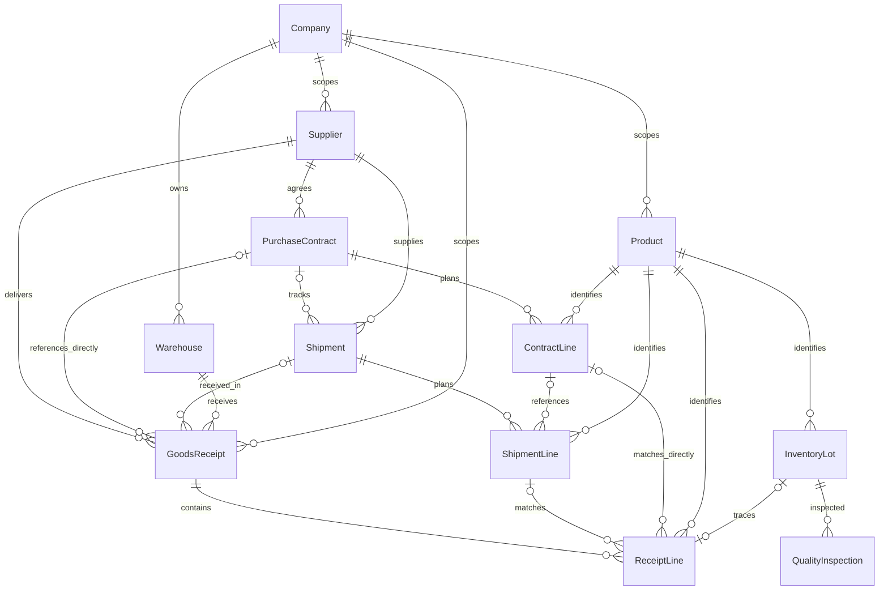
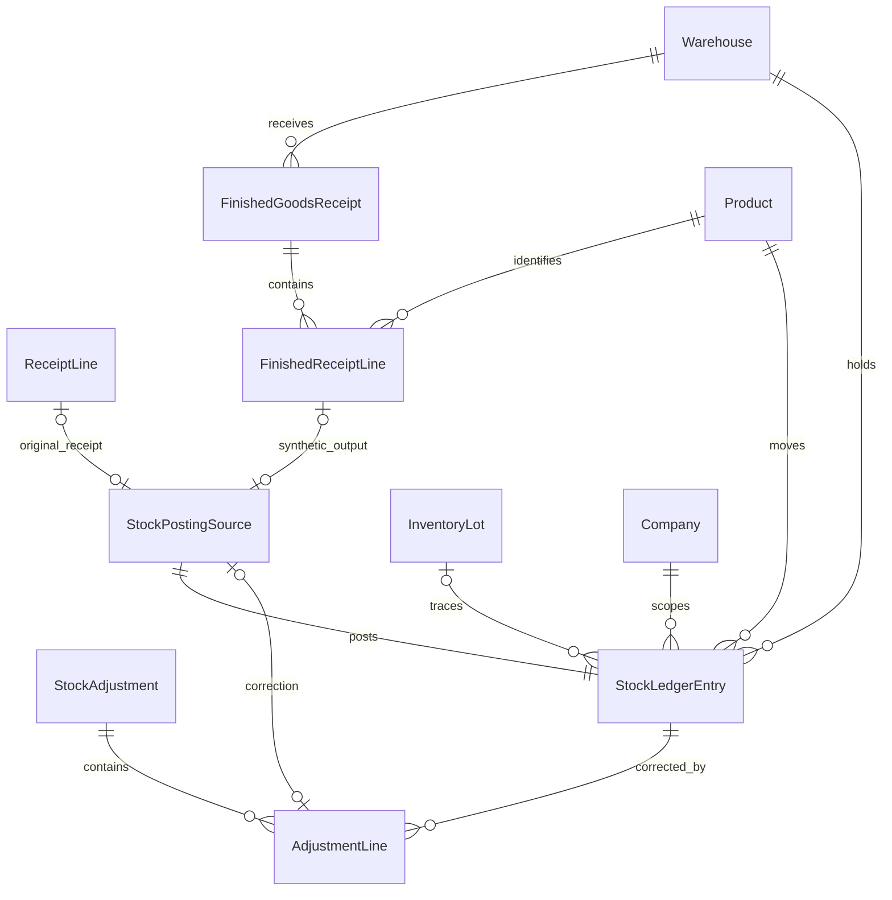

# Domain model — reviewed Phase 0 proposal

Source: brief §§4–6, 10, 12 and 14. Schema choices are [ASSUMPTION], not approved operating policy. [Confirmed rules](business-rules.md) constrain the design; [open questions](open-questions.md) constrain real use. Diagrams describe Phases 1–3, not tables already implemented.

## Procurement and provenance

Shipment is InboundShipment in the brief; ReceiptLine is GoodsReceiptLine. Empty drafts are valid, hence zero-or-more lines; confirmation requires at least one valid line. Each RAW line must have one internal lot by confirmation. Lots may exist before confirmation for laboratory inspection and create no stock by themselves. Initially a RAW lot belongs to at most one receipt line. Split separate physical lots into separate lines. Supplier batch identifiers can recur across partial arrivals and are not globally unique internal lot keys.

Every business entity carries company scope even where omitted from the diagram. Warehouse, supplier, product, contract, shipment, line and lot must belong to the same company. When both contract and shipment are supplied their relationship and supplier must agree. A direct contract-linked receipt needs no fabricated shipment. A receipt links to at most one shipment; matched lines support partial quantities. Unmatched receipt lines remain valid direct receipts but do not count against invented planned lines.

## Posting sources, corrections and finished goods

StockPostingSource is a proposed internal adapter, not a user-created document. It has exactly one protected source-line FK: receipt, finished receipt or adjustment. A database check enforces the exclusive choice; each non-null source FK is unique. StockLedgerEntry.source is unique and non-null. Source, movement and confirmation are committed in one transaction. This preserves one original movement per receipt line without forcing finished output or corrections to pretend to be supplier receipts. No unconstrained model-name/text-ID references.

FinishedGoodsReceipt belongs to inventory: company, FINISHED warehouse, effective date, actor, state and explicit synthetic origin. It has no fake supplier. Its lines record finished SKU, counted bags and nominal mass. It creates no wheat or empty-bag consumption in Phases 1–3. Production later supplies a real source. Documented opening balances need their own approved source type before real pilot migration, never a silently editable balance.

## Fields and constraints

- Company/Warehouse: unique (company, type), restricted to RAW/FINISHED, permits at most two. Idempotent seed and setup checks establish both; prevent deletion once referenced. This is the pilot layout, not every future plant's physical structure.
- Product: company, SKU, category, base unit, optional grade and packaging specification. Unique company/SKU. Used base units and packaging specifications cannot be redefined after posting; create a new version/SKU when needed. Services never post stock. Validate material versus finished-product warehouse compatibility.
- GoodsReceipt: company, supplier, RAW warehouse, optional shipment/contract, effective date, recorded timestamp, creator, confirmer, confirmation timestamp, version, status and protected evidence. Posted facts cannot be rewritten by header changes.
- ReceiptLine: product, input quantity/unit, normalized posting quantity, conversion snapshot, measurement basis, measurement time, measured/recorded-by actor and evidence. Keep declared, received and quality-accepted quantities distinct. Optional price has currency and price unit (per tonne differs from per kg). Unknown amounts are null, not zero.
- Quantity to post [OPEN / Q-02, Q-03]: the ledger represents documented physical custody, never automatically planned or quality-accepted quantity. The synthetic path uses explicitly recorded received quantity. Real received/rejected/held ownership treatment needs an answer; quality status alone never changes quantity.
- ContractLine/ShipmentLine: planned product, quantity/unit and optional known commercial terms. Progress sums matched posted actual quantities, including corrections, in the same unit. Preserve original plans and record any later revision. Do not sum unlike products/units.
- InventoryLot: internal ID, company/product, supplier batch reference if known and receipt provenance. Identity does not imply physical segregation or FIFO. Inspection can precede posting. Changing inspected draft provenance requires a replacement lot and retention of superseded evidence, never reassignment to another product.
- QualityInspection: lot, inspection time, employee, result, comment and protected passport/protocol. Retain completed history; new results supersede explicitly. No invented tests, limits or release authority.
- StockLedgerEntry: company, warehouse, product, optional lot, signed base quantity/unit, optional signed package count and nominal kg snapshot, effective date, recorded timestamp, actor, measurement basis and unique source. Nonzero quantities, consistent lot/product/company, protected references. Index company/warehouse/product/effective date, lot and recorded timestamp.
- Enforcement: row checks and unique constraints handle local invariants. Cross-row company/product validation requires PostgreSQL guards (constraint triggers or composite referenced keys selected during schema work), plus service checks for usable errors. Row CHECKs alone do not validate related records. Runtime credentials cannot bypass immutability; privileged maintenance is separate.

## Units and measurement [ASSUMPTION constrained by §4.3]

Wheat and flour mass use Decimal kg; tonnes convert explicitly at 1,000 kg per tonne. Empty packaging uses pieces. Packaged flour retains whole counted bags and the immutable nominal kg-per-bag snapshot on the same posting, deriving nominal kg without a second independent movement. Synthetic AT-06: 200 bags × 50 kg = 10,000 nominal kg, with COUNTED provenance, not WEIGHED.

Actual weighed package mass is a separate observation; it does not overwrite count or nominal conversion. Q-07 decides its operational treatment. Reject incompatible units and non-representable values instead of silently rounding. Select numeric precision during Phase 1 from documented input limits. Monetary/FX rounding remains OPEN. Original amount/currency, exchange-rate date/source and any future converted amount stay distinct; never assume an unknown rate is 1.

## Corrections and reversal [ASSUMPTION]

StockAdjustment: company, effective date, reason, creator, confirmer, state and original document. Each line references an existing entry and records a signed correction for the same company/warehouse/product/lot/unit. An erroneous item/warehouse needs explicit linked reversing and replacement effects, not an edited foreign key. Require permission and reason. Demo users cannot approve their own disputed adjustments.

Multiple partial corrections are allowed with unique source lines. Reversal must include the current document family: +100 followed by −10 leaves +90, so reversing only −100 is wrong. Proposed algorithm: lock the original document and adjustment family; create one inverse for each active unreversed effect (+100 → −100 and −10 → +10); uniquely reference each reversed entry; record family reversal and audit atomically. Net quantity is zero. Repeating family reversal is a no-op; further corrections to that reversed family are rejected. All original history remains. This is an accounting correction, not evidence of physical goods leaving; returns need their own workflow.

Do not automatically reverse after downstream consumption/dispatch without an approved dependency/negative-stock policy (Q-08). Initial synthetic receipt tests have no downstream issues; unresolved real cases require review. Backdating and period locks remain OPEN, not unrestricted by default.

## States [ASSUMPTION]

- Receipt / synthetic finished receipt: DRAFT → CONFIRMED → REVERSED; DRAFT → CANCELLED. No stock for drafts/cancelled drafts. Partial corrections leave the original CONFIRMED with visible history. No return to editable draft.
- Adjustment: DRAFT → CONFIRMED or DRAFT → CANCELLED. Confirmed facts are immutable; inverse entries can offset them later.
- Shipment: DRAFT → IN_TRANSIT → ARRIVED → CLOSED. Allow audited DRAFT → ARRIVED when historical dispatch details are missing. Tracking is optional, never a prerequisite for receiving. Cancellation requires no active receipts. Partial receipt progress is derived separately. Short/over-delivery closure needs an authorised reason, not an invented tolerance. Reversing a receipt on a closed shipment flags closure for review; it does not rewrite the plan or hide the discrepancy.
- Quality: NOT_CHECKED means no completed inspection; PENDING, PASSED and FAILED describe inspection state/results. Partial acceptance needs scoped quantities/evidence after Q-03; do not automatically label a whole lot PASSED. Availability/release is separate.

## Supporting and future records

Phase 2 includes PurchaseCharge: company, type (delivery/customs/rail/other), service date, known amount/currency, counterparty if known, source evidence and a protected shipment or receipt link (both allowed only if consistent). It records an actual known cost, not allocation or payment. Late charges append records; they do not change confirmed receipt quantities. Known receipt price plus recorded charges is not automatically final landed cost.

AuditEvent records actor/time/action/object/reason and significant prior/new state. Attachment has protected parent links and authorised downloads. OperationKey stores retry identity and a protected result. CompanyMembership and warehouse/action grants scope access. These helpers are not extra paperwork for workers.

Later: PurchaseChargeAllocation links charges to receipts/lots with explicit policy/version. SupplierObligation has one recognised financial source and may link receipts/invoices without duplicate recognition. PaymentAllocation supports many payments to one obligation and one payment to many obligations. InventoryValuationEntry links quantity sources, costs, currency and costing version separately from quantity. MonthlyClose distinguishes PRELIMINARY/CLOSED results. Plant, Department, StorageLocation, production/WIP, dispatch, stocktaking and external-import references expand with their workflows. No arbitrary financial policy is embedded now.
